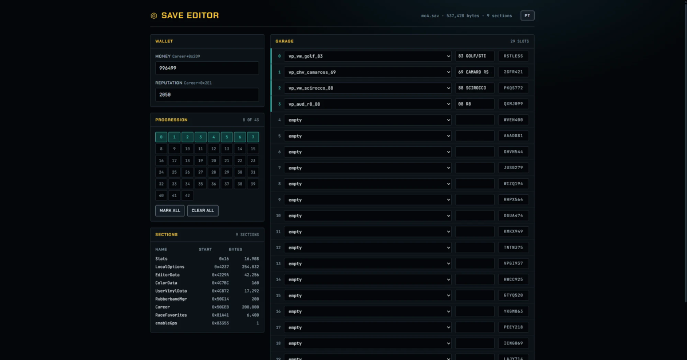

# mc4.sav — Midnight Club: Los Angeles save editor

**English** · [Português](README.pt-BR.md)

Save editor and format documentation for **Midnight Club: Los Angeles** (Xbox 360, Complete Edition),
as written by the [MC_LA_Recompiled](https://github.com/robertoaraujo77/MC_LA_Recompiled) PC runtime.



The editor is useful. The format documentation below is the point: as far as I can tell the
`mc4.sav` layout has never been published anywhere. The save editors floating around fan forums
are closed binaries from 2013 with no notes attached, so anyone who wants to touch this file
starts from zero. This repository is the notes.

## Credits

- **[robertoaraujo77 / MC_LA_Recompiled](https://github.com/robertoaraujo77/MC_LA_Recompiled)** — the recompiled PC runtime this work is based on. Every byte documented here was read from a save its ReXGlue runtime produced, and its `userdata` layout is what the tools expect. None of this exists without that project.
- **holdmysocks** — the original MCLA recompilation, and **RenanQueiroz** for the fork the project above builds on.
- **u/leveldock6** — the [r/midnightclub guide](https://www.reddit.com/r/midnightclub/comments/17hht3b/guide_unlocking_the_audi_r8_for_purchase_in_mcla/) that located the Audi R8 lock in `tune/vehicle/0xe94bde63` inside `xarchive_cache.rpf`.
- **[nicolas-found42 / carmodels#38](https://github.com/nicolas-found42/carmodels/pull/38)** — documented the RPF3 container and the Jenkins one-at-a-time name hashing, which is how the archive side of this was understood.

## Scope

Works on the save the recompiled runtime writes:

```
<game folder>\userdata\B13EBABEBABEBABE\545407F8\00000001\mc4.sav\mc4.sav
```

A save from a real Xbox 360 lives inside an STFS container. Extract the inner `mc4.sav` first;
these tools read the plain file, not the package. The sibling `mc4.sav.header` is a small
XContent header with no hash of the contents, so it needs no changes after an edit.

Close the game before editing. Both tools refuse to write a file whose structure does not
validate, and neither one ever changes the file size.

## Tools

**[Open the editor](https://onlyzennnn.github.io/mcla-save-editor/)** — drop the save in, edit, download the patched file. It runs entirely in the browser; the save never leaves your machine. `index.html` is the whole thing, so downloading that one file and opening it offline works the same way.

For the command line, `scripts/mcla-save-editor.ps1` covers `info`, `garage`, `roster`, `cars`, `setcar`, `money`, `rep`, `progress`, `stats`, `find`, `get`, `set`, `diff` and `selftest`.

The UI text in both is Brazilian Portuguese.

## Format

Integers are **big-endian** throughout: the game is PowerPC. There is no checksum anywhere in
the file, so edits need no rehash and no resigning. The section walk ending exactly at EOF is
the only integrity check there is, and both tools use it as one.

### Container

```
u32  capacity        (0x0E in every save seen)
u32  section count
```

then, repeated until EOF:

```
u32  name length
     name  (ASCII, no terminator)
u8   flag
u32  data size
     data[size]
```

A 537,428-byte save holds nine sections:

| Section | Flag | Size |
|---|---|---|
| `Stats` | 1 | 16,908 |
| `LocalOptions` | 9 | 254,032 |
| `EditorData` | 5 | 42,256 |
| `ColorData` | 1 | 160 |
| `UserVinylData` | 1 | 17,292 |
| `RubberbandMgr` | 2 | 200 |
| `Career` | 11 | 200,000 |
| `RaceFavorites` | 1 | 6,400 |
| `enableGps` | 1 | 1 |

Offsets below are relative to a section's **data** start, not to the file.

### Career

| Offset | Type | Meaning |
|---|---|---|
| `+0x2D9` | u32 | Money |
| `+0x2DD` | u32 | Unknown. **Do not write.** See [What does not work](#what-does-not-work). |
| `+0x2E1` | u32 | Reputation |
| `+0x2E5` | u32 | Number of progression blocks (43) |
| `+0x2E9` | — | Progression blocks, 65 bytes each: name, zero padding, and a completion flag in the **last** byte of the block |

Career also holds race series names (`hw_tournament1`, `dt_local_hangout1_series`, and so on) and
per-class counters in 65-byte blocks named `Tuner_0`, `Muscle_0`, `Exotic_0`, `Luxury_0`. Those
counters track races run with each class; they are not unlocks.

### LocalOptions

| Offset | Type | Meaning |
|---|---|---|
| `+0x53F` | u8 | Number of cars the game reads |
| `+0x543` | u8 | Index of the last car (count minus one) |
| `+0x24FD` | — | Garage slots, 29 of them, 8,176 bytes each |

**The garage is read sequentially from slot 0 and stops at the counter.** A car written into a
slot past that counter is in the file and invisible in game. This is the single most useful fact
in this document and it cost an evening to find.

Inside a slot:

| Offset | Size | Meaning |
|---|---|---|
| `+0` | 32 | Vehicle prefab name, NUL-terminated, padded with `0xCD` |
| `+32` | 33 | Garage list label (`83 GOLF/GTI`), same termination and padding |
| `+2186` | 7 | License plate, exactly seven characters |
| `+687`, `+1215` | 1 | Per-slot id, assigned by the game |

A slot the game filled by purchase and a slot written by hand differ only in those fields. The
slot carries no wheel, part or tuning data.

### Stats

Records of 16 bytes. The FourCC sits at an **absolute** file offset where `offset % 16 == 2`:

```
fourcc[4]  u32 id @+4  u8 type @+8  u24 @+9  value @+12
```

Type `0x28` and `0x00` mean the value is a float; everything else is an unsigned integer. A
normal save holds around 100 records: `gWIN` wins, `gDAM` damage, `gNIT` nitrous, `tPUR` cars
purchased, and so on.

### Vehicle names

The garage stores the prefab name as text, and only names the game knows will load. The 48 valid
names come from `tune/vehicle/0xe94bde63` inside `xarchive_cache.rpf`; both tools carry the list.
The pattern is `vp_<make>_<model>_<year>`, for example `vp_vw_golf_83`, `vp_chv_camaross_69`,
`vp_aud_r8_08`.

Those names exist **only** as Jenkins one-at-a-time hashes in the RPF3 table of contents. A
plain-text search over the whole 7.8 GB disc image finds none of them, which is why grepping the
game files for a car name never works.

## Verified in game

Read on screen in a running game, not inferred:

- Money at `Career+0x2D9`, watched change twice
- The car counter at `LocalOptions+0x53F`, seen going 2 to 3 the moment a car was bought
- Slot prefab name and label, confirmed by a car appearing in the garage with the right model and the right text
- Reputation at `Career+0x2E1`, matching the number on screen
- Progression flags, matching the player's actual career position

## What does not work

Spending time here again is not necessary.

- **`Career+0x2DD`** crashes the game on load when set to 0, 1 or 4. It did not change across a
  real in-game group unlock either, so it is not the vehicle group.
- **Reputation does not gate vehicle groups.** Raising it to 500,000 unlocked nothing in the showroom.
- **Progression flags do not gate them either.** All 43 marked complete changed nothing.
- **The Audi R8 lock is not in the save.** It lives in `tune/vehicle/0xe94bde63` inside
  `xarchive_cache.rpf`, as Social Club lines on the R8's `Vehicle` block. Writing `vp_aud_r8_08`
  into a garage slot does nothing until that game file is modded. Two r/midnightclub threads carry
  that mod: the [original guide](https://www.reddit.com/r/midnightclub/comments/17hht3b/guide_unlocking_the_audi_r8_for_purchase_in_mcla/)
  and a [later purchasable-R8 post](https://www.reddit.com/r/midnightclub/comments/1i0crmk/midnight_club_la_purchasable_audi_r8_xbox_360_mod/).
  Even with the mod the car's `UnlockingGroup A0` still requires group 4 for the showroom.
- **Wheels cannot be fixed from the save.** A purchased slot and a hand-written slot are
  byte-identical outside name, label, plate and id, so a car injected into the garage renders with
  whatever the game resolves by default.

Still open: which field unlocks vehicle groups. `RubberbandMgr` holds three values that went
`[14, 2, 2]` to `[-4, 3, 3]` across a session that included an unlock, which makes it the only
live candidate. That session also included several races, so the signal is not isolated.

## Not in this repository

No game data, by design. The ISO, `xarchive_cache.rpf`, `0xe94bde63` and any modded archive all
belong to Rockstar and are not redistributed here. Personal save files are excluded too. The
`.gitignore` is set up to keep them out by accident as well as on purpose.

## License

MIT. See [LICENSE](LICENSE).
