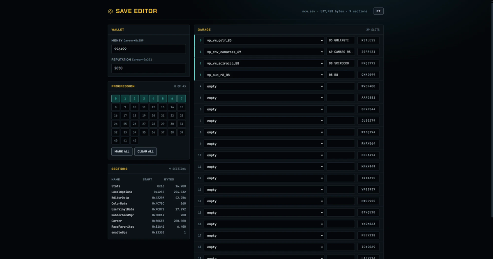

# mc4.sav — editor de save do Midnight Club: Los Angeles

[English](README.md) · **Português**

Editor de save e documentação do formato de **Midnight Club: Los Angeles** (Xbox 360, Complete Edition),
do jeito que o runtime de PC do [MC_LA_Recompiled](https://github.com/robertoaraujo77/MC_LA_Recompiled) grava.



O editor é útil. A documentação do formato abaixo é o ponto: até onde eu consegui apurar, o layout
do `mc4.sav` nunca foi publicado em lugar nenhum. Os editores que circulam em fórum são binários
fechados de 2013, sem uma linha de anotação junto, então quem quiser mexer nesse arquivo hoje começa
do zero. Este repositório é a anotação que faltava.

## Créditos

- **[robertoaraujo77 / MC_LA_Recompiled](https://github.com/robertoaraujo77/MC_LA_Recompiled)** — o runtime recompilado em que tudo isto se baseia. Cada byte documentado aqui foi lido de um save que o runtime ReXGlue dele produziu, e é o layout de `userdata` dele que as ferramentas esperam. Nada disto existe sem esse projeto.
- **holdmysocks** — a recompilação original do MCLA, e **RenanQueiroz** pelo fork em que o projeto acima se apoia.
- **u/leveldock6** — o [guia no r/midnightclub](https://www.reddit.com/r/midnightclub/comments/17hht3b/guide_unlocking_the_audi_r8_for_purchase_in_mcla/) que localizou a trava do Audi R8 em `tune/vehicle/0xe94bde63`, dentro do `xarchive_cache.rpf`.
- **[nicolas-found42 / carmodels#38](https://github.com/nicolas-found42/carmodels/pull/38)** — documentou o contêiner RPF3 e o hash Jenkins one-at-a-time dos nomes, que foi como o lado do arquivo compactado ficou compreensível.

## Alcance

Funciona no save que o runtime recompilado grava:

```
<pasta do jogo>\userdata\B13EBABEBABEBABE\545407F8\00000001\mc4.sav\mc4.sav
```

Save de Xbox 360 de verdade vem dentro de um contêiner STFS. Extraia o `mc4.sav` de dentro dele
primeiro; estas ferramentas leem o arquivo cru, não o pacote. O `mc4.sav.header` ao lado é um
header XContent pequeno, sem hash do conteúdo, então não precisa de ajuste depois da edição.

Feche o jogo antes de editar. As duas ferramentas se recusam a gravar num arquivo cuja estrutura
não valide, e nenhuma delas muda o tamanho do arquivo.

## Ferramentas

**[Abrir o editor](https://onlyzennnn.github.io/mcla-save-editor/)** — arraste o save, edite, baixe o arquivo corrigido. Roda inteiro no navegador; o save não sai da sua máquina. O `index.html` é a ferramenta toda, então baixar esse único arquivo e abrir offline dá no mesmo. Tem seletor de idioma no canto.

Ele edita dinheiro, reputação, progressão da carreira, os slots da garagem (veículo, rótulo, placa)
e **as melhorias de desempenho** — um botão por carro maximiza as treze categorias, e um botão
maximiza a garagem inteira.

Para linha de comando, o `scripts/mcla-save-editor.ps1` cobre `info`, `garage`, `roster`, `cars`,
`setcar`, `money`, `rep`, `progress`, `stats`, `find`, `get`, `set`, `diff` e `selftest`. O
desempenho só existe no editor do navegador.

O `tests/render.test.js` roda o script de dentro da página contra um save sintético num DOM mínimo
e exige que cada campo realmente chegue nos bytes. Passando um caminho, roda no seu `mc4.sav`.

## Formato

Os inteiros são **big-endian** em todo o arquivo: o jogo é PowerPC. Não existe checksum em lugar
nenhum, então editar não exige refazer hash nem reassinar. O walk das seções terminar exatamente
no fim do arquivo é a única verificação de integridade que existe, e as duas ferramentas usam isso
como uma.

### Contêiner

```
u32  capacidade      (0x0E em todo save que eu vi)
u32  numero de secoes
```

e então, repetindo até o fim do arquivo:

```
u32  tamanho do nome
     nome  (ASCII, sem terminador)
u8   flag
u32  tamanho dos dados
     dados[tamanho]
```

Um save de 537.428 bytes tem nove seções:

| Seção | Flag | Tamanho |
|---|---|---|
| `Stats` | 1 | 16.908 |
| `LocalOptions` | 9 | 254.032 |
| `EditorData` | 5 | 42.256 |
| `ColorData` | 1 | 160 |
| `UserVinylData` | 1 | 17.292 |
| `RubberbandMgr` | 2 | 200 |
| `Career` | 11 | 200.000 |
| `RaceFavorites` | 1 | 6.400 |
| `enableGps` | 1 | 1 |

Os offsets abaixo são relativos ao início dos **dados** da seção, não ao arquivo.

### Career

| Offset | Tipo | Significado |
|---|---|---|
| `+0x2D9` | u32 | Dinheiro. Veja a nota abaixo: o offset é calculado, não fixo |
| `+0x2DD` | u32 | Desconhecido. **Não escreva aqui.** Veja [o que não funciona](#o-que-não-funciona). |
| `+0x2E1` | u32 | Reputação |
| `+0x2E5` | u32 | Quantidade de blocos de progressão (43) |
| `+0x2E9` | — | Blocos de progressão, 65 bytes cada: nome, zeros, e o flag de concluído no **último** byte do bloco |

O dinheiro não fica num offset fixo. O `Career+4` é um byte de versão que precisa ler `0x0B`, o
`Career+5` é um u32 de contagem, e o dinheiro fica em `Career + 9 + contagem * 0x30`. Todo save
visto aqui tem contagem 15, o que dá `0x2D9` — mas um save com outra contagem põe o dinheiro em
outro lugar, então calcule. Essa estrutura é confirmada pelo [unknownv2/save-editor-tools](https://github.com/unknownv2/save-editor-tools/blob/dev/Midnight%20Club%20LA/MidnightClubLA.cs),
um editor de 2013 cujo leitor bate byte a byte com este contêiner.

A `Career` também guarda os nomes das séries de corrida (`hw_tournament1`, `dt_local_hangout1_series`
e por aí) e contadores por classe em blocos de 65 bytes chamados `Tuner_0`, `Muscle_0`, `Exotic_0`,
`Luxury_0`. Esses contadores registram corridas feitas com cada classe; não são desbloqueios.

### LocalOptions

| Offset | Tipo | Significado |
|---|---|---|
| `+0x53F` | u8 | Quantos carros o jogo lê |
| `+0x543` | u8 | Índice do último carro (quantidade menos um) |
| `+1293` | — | Blocos de desempenho, mesmo passo de 8.176 dos slots |
| `+0x24FD` | — | Slots da garagem, 29 deles, 8.176 bytes cada |

**A garagem é lida em sequência a partir do slot 0 e para no contador.** Um carro gravado num slot
além desse contador está no arquivo e invisível no jogo. Esse é o fato mais útil deste documento e
custou uma noite inteira pra aparecer.

Dentro de um slot:

| Offset | Tamanho | Significado |
|---|---|---|
| `+0` | 32 | Nome do prefab do veículo, terminado em `\0`, preenchido com `0xCD` |
| `+32` | 33 | Rótulo da lista da garagem (`83 GOLF/GTI`), mesma terminação e preenchimento |
| `+2186` | 7 | Placa, exatamente sete caracteres |
| `+687`, `+1215` | 1 | Id por slot, atribuído pelo jogo |

Um slot que o jogo preencheu numa compra e um slot escrito à mão diferem apenas nesses campos, por
isso um carro injetado aparece com a roda que o jogo escolher por padrão. O resto dos 8.176 bytes
não está vazio: um carro carrega perto de 4.000 bytes de dado denso e desalinhado aí dentro, que
muda conforme ele é customizado. A customização visual não foi decodificada.

### Melhorias de desempenho

Moram num array próprio, **não** no slot da garagem:

```
LocalOptions + 1293 + N * 8176
```

Mesmo passo dos slots, mas a base fica exatamente um passo antes, então o bloco do carro nomeado no
slot N fica um slot "atrás" dele. Esse deslocamento é o que escondeu a coisa: comprar uma peça para
o carro do slot 1 escreve nos bytes que parecem ser do slot 0.

| Offset no bloco | Tamanho | Significado |
|---|---|---|
| `+95` | 13 | Um byte por categoria de upgrade, nível `0`, `1` ou `2` |
| `+126` | 1 | Porcentagem de tune que a loja mostra, de `0` a `100` |

A porcentagem é a soma dos treze níveis sobre 26. Treze em nível 2 dá 100%, treze em nível 1 dá
50%, e dois níveis soltos aparecem como 8%. Numa garagem de 12 carros, todos bateram com essa
conta. Gravar nível 2 nos treze bytes e 100 no `+126` foi **confirmado em jogo**: o carro passou a
marcar 100% de tune com todas as categorias instaladas.

### Contabilidade por carro

```
LocalOptions + 246573 + N * 336
```

Um segundo array por carro, indexado pelo **hash Jenkins one-at-a-time do nome do veículo** em
`+71`, com o dinheiro acumulado gasto naquele carro em `+77` (espelhado em `+149`) e uma máscara em
`+140..+144` que registra as compras. É só contabilidade: zerar um registro inteiro não mudou nada
em jogo, então não vale a pena escrever aqui.

### Stats

Registros de 16 bytes. O FourCC fica num offset **absoluto** de arquivo onde `offset % 16 == 2`:

```
fourcc[4]  u32 id @+4  u8 tipo @+8  u24 @+9  valor @+12
```

Tipo `0x28` e `0x00` significam que o valor é float; qualquer outro é inteiro sem sinal. Um save
normal tem cerca de 100 registros: `gWIN` vitórias, `gDAM` dano, `gNIT` nitro, `tPUR` carros
comprados, e assim por diante.

### Nomes de veículo

A garagem guarda o nome do prefab como texto, e só nomes que o jogo conhece carregam. Os 48 nomes
válidos vêm de `tune/vehicle/0xe94bde63`, dentro do `xarchive_cache.rpf`; as duas ferramentas
carregam a lista. O padrão é `vp_<marca>_<modelo>_<ano>`, por exemplo `vp_vw_golf_83`,
`vp_chv_camaross_69`, `vp_aud_r8_08`.

Esses nomes existem **apenas** como hash Jenkins one-at-a-time no índice do RPF3. Uma busca por
texto puro na imagem de disco inteira, 7,8 GB, não acha nenhum deles — que é o motivo de grepar os
arquivos do jogo atrás de nome de carro nunca funcionar.

## Verificado em jogo

Lido na tela com o jogo rodando, não deduzido:

- Dinheiro em `Career+0x2D9`, visto mudar duas vezes
- O contador de carros em `LocalOptions+0x53F`, visto ir de 2 para 3 no momento em que um carro foi comprado
- Nome do prefab e rótulo do slot, confirmados por um carro aparecer na garagem com o modelo certo e o texto certo
- Reputação em `Career+0x2E1`, batendo com o número da tela
- Flags de progressão, batendo com a posição real do jogador na carreira
- Melhorias de desempenho: gravar nível 2 nos treze bytes do `+95` e 100 no `+126` fez o carro
  marcar 100% de tune na loja, com todas as categorias instaladas

## O que não funciona

Não precisa gastar tempo aqui de novo.

- **`Career+0x2DD`** trava o jogo no carregamento com 0, 1 ou 4. E não mudou nem num desbloqueio de
  grupo feito de verdade dentro do jogo, então não é o grupo de veículos.
- **Reputação não controla o grupo de veículos.** Subir para 500.000 não destravou nada na loja.
- **Os flags de progressão também não.** As 43 marcadas como concluídas não mudaram nada.
- **A trava do Audi R8 não está no save.** Ela vive em `tune/vehicle/0xe94bde63`, dentro do
  `xarchive_cache.rpf`, como linhas de Social Club no bloco `Vehicle` do R8. Escrever
  `vp_aud_r8_08` num slot da garagem não faz nada enquanto esse arquivo do jogo não for moddado.
  Dois tópicos do r/midnightclub trazem esse mod: o [guia original](https://www.reddit.com/r/midnightclub/comments/17hht3b/guide_unlocking_the_audi_r8_for_purchase_in_mcla/)
  e um [post posterior com o R8 comprável](https://www.reddit.com/r/midnightclub/comments/1i0crmk/midnight_club_la_purchasable_audi_r8_xbox_360_mod/).
  E mesmo com o mod, o `UnlockingGroup A0` do carro continua exigindo o grupo 4 para a loja.
- **Roda não dá para corrigir pelo save.** Um slot comprado e um slot escrito à mão são
  byte-idênticos fora de nome, rótulo, placa e id, então um carro injetado na garagem renderiza com
  o que o jogo resolver por padrão.

- **A contabilidade por carro não é o estado dos upgrades.** Zerar um registro inteiro de 336
  bytes, e separadamente ligar todos os bits da máscara em `+140..+144`, deixaram a loja exatamente
  como estava.
- **O `RubberbandMgr` não é dial de dificuldade.** São três int32 seguidos de 188 bytes de
  preenchimento `0xCD`. Os valores foram de `[14, 2, 2]` para `[-4, 3, 3]` ao longo de uma sessão,
  o que é contabilidade de execução, não configuração.

Continua em aberto qual campo desbloqueia os grupos de veículo, e onde mora a customização visual.
O grupo do veículo em si é dado do jogo, não do save — o `tune/vehicle/0xe94bde63` traz um `Group` e
um `UnlockingGroup` por carro, junto de `BaseSpeed`, `ModsSpeed`, `BaseAccel`, `ModsAccel`,
`BaseHndlg` e `ModsHndlg`. Os valores `Mods` são o teto que um carro totalmente melhorado alcança,
e é para ele que os 13 níveis acima interpolam.

## O que não está neste repositório

Nenhum dado do jogo, por decisão. A ISO, o `xarchive_cache.rpf`, o `0xe94bde63` e qualquer arquivo
moddado pertencem à Rockstar e não são redistribuídos aqui. Saves pessoais também ficam de fora. O
`.gitignore` está montado para mantê-los fora por acidente, não só por disciplina.

## Licença

MIT. Veja [LICENSE](LICENSE).
